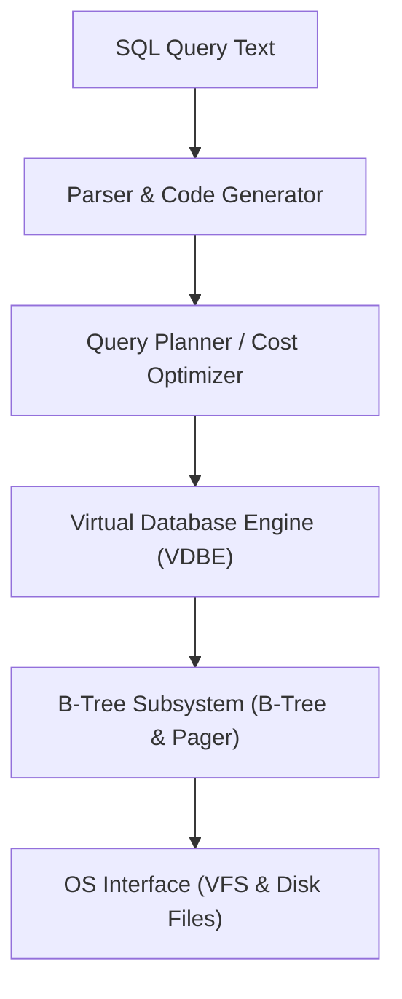
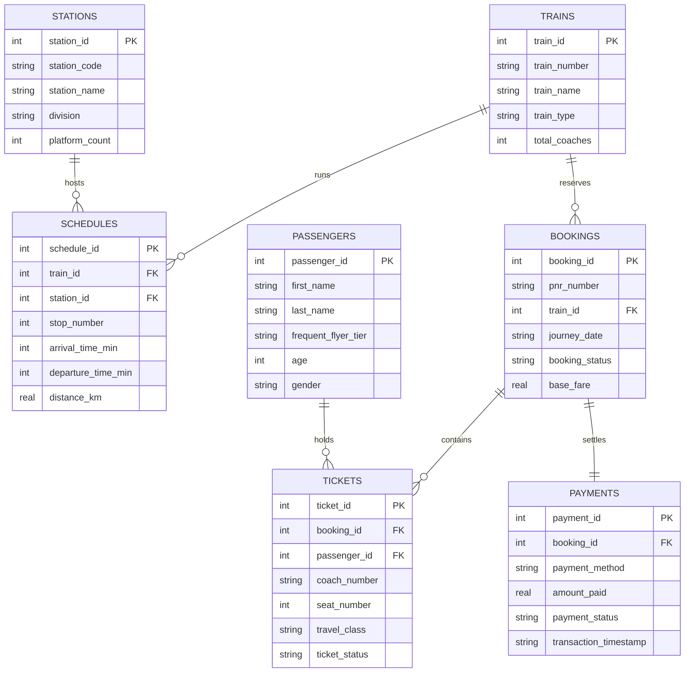

# Track H: DBMS Architecture & SQLite Internals

## 1. Executive Overview

Track H implements a production-grade Database Management System (DBMS) query optimization study using SQLite as the target engine. Database query optimization is fundamentally a multi-objective trade-off between read latency, write overhead, and secondary storage consumption. This track demonstrates how physical access path selection—specifically secondary B-tree index selection—can be formulated, solved, and validated using rigorous mathematical optimization and empirical benchmarking.

---

## 2. SQLite Engine Architecture

SQLite is a serverless, zero-configuration, transactional database engine implementing the relational model via a modular pipeline:

### 2.1 The Virtual Database Engine (VDBE)
The VDBE is a register-based virtual machine executing bytecode instructions compiled from SQL statements. When a query is parsed:
1. The SQL text is tokenized and parsed into an Abstract Syntax Tree (AST).
2. The SQLite Query Optimizer analyzes table schemas, available indexes, and catalog statistics (`sqlite_stat1` generated via `ANALYZE`).
3. The optimizer emits an execution plan encoded as VDBE opcodes (such as `OpenRead`, `SeekGE`, `IdxRowid`, `Column`, `ResultRow`).
4. The VDBE executes the bytecode against the underlying B-Tree storage pages.

### 2.2 B-Tree Storage & Page Architecture
SQLite stores all tables and secondary indexes as B-trees inside a single monolithic disk file:
- **Table B-Trees (B* Trees)**: Leaf pages contain the actual data rows (payload). The 64-bit integer rowid serves as the primary search key.
- **Index B-Trees**: Interior and leaf pages store index keys accompanied by rowids. Finding a matching record in an unclustered index requires an initial B-tree traversal to locate the rowid, followed by a secondary seek on the table B-tree to retrieve unindexed payload columns.
- **Covering Indexes**: When all columns requested by a `SELECT` clause, `WHERE` predicate, and `ORDER BY` clause reside within the index itself, SQLite executes an index-only scan, completely bypassing table page lookups.

---

## 3. Relational Schema Design: Railway Reservation System

To evaluate real-world query optimization, Track H models a high-concurrency National Railway Reservation and Ticketing System across 7 normalized relational tables:

### 3.1 Scale & Footprint
Under deterministic generation (seed 42, scale factor 0.60):
- **Stations**: 60 major junctions and terminals.
- **Trains**: 300 express and superfast services.
- **Schedules**: 5,348 arrival/departure checkpoints.
- **Passengers**: 15,000 registered accounts.
- **Bookings**: 36,000 reservation transactions.
- **Tickets**: 89,893 issued passenger tickets.
- **Payments**: 36,000 financial settlements.
- **Total Rows**: 179,760 records.
- **Physical SQLite Database Size**: 9.46 MB.

---

## 4. Query Planner & Execution Plan Inspection

SQLite inspects candidate execution paths using a cost-based model. We interrogate the planner using `EXPLAIN QUERY PLAN <sql>`:

### 4.1 Plan Operators
- **`SCAN <table>`**: Full table scan traversing every database page in the table B-tree ($O(N)$ page reads). In the absence of indexes, filtering on non-key attributes requires scanning all 36,000 booking rows or 89,893 ticket rows.
- **`SEARCH <table> USING INDEX <index_name>`**: Logarithmic traversal down an index B-tree ($O(\log M)$ page reads) followed by point lookups.
- **`SEARCH <table> USING COVERING INDEX <index_name>`**: Zero table page reads; all requested columns are satisfied directly from index leaf pages.
- **`USE TEMP B-TREE FOR ORDER BY / GROUP BY`**: When no index exists with matching sort order, SQLite builds an in-memory or spill-to-disk temporary B-tree to sort intermediate result sets ($O(K \log K)$ sorting cost).

### 4.2 SQLite Catalog Statistics (`ANALYZE`)
To enable realistic index cost modeling, our benchmark runner executes `ANALYZE;` immediately following index creation. This populates `sqlite_stat1`, providing the planner with exact distribution histograms and average row estimates for index prefixes.

