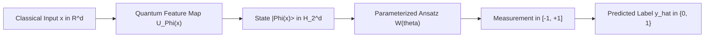

# Track I: Quantum Machine Learning vs. Classical Machine Learning

## 1. Mathematical Framework of Quantum Machine Learning

Quantum Machine Learning (QML) replaces classical feature transformations and parameter weight matrices with high-dimensional Hilbert space embeddings and parameterized quantum unitary operators.

### 1.1 Quantum Feature Map (ZZ Feature Map with Angle Encoding)
A classical feature vector $x = (x_0, x_1) \in \mathbb{R}^2$ is embedded into a 2-qubit state $|\Phi(x)\rangle$ using single-qubit rotations followed by entangling phase gates:
$$
U_\Phi(x) = \exp\left(i x_0 x_1 Z_0 Z_1\right) \left[ R_y(x_0) \otimes R_y(x_1) \right]
$$
In elementary circuit gates:
1. $R_y(x_0)$ on qubit 0, $R_y(x_1)$ on qubit 1.
2. $CX(0, 1)$.
3. $R_z(x_0 \cdot x_1)$ on qubit 1.
4. $CX(0, 1)$.
This non-linear transformation projects the classical 2D data into a 4-dimensional complex Hilbert space $\mathbb{C}^4$, enabling quantum kernel separation of non-linearly separable patterns.

### 1.2 Variational Quantum Circuit (PQC Ansatz)
The parameterized unitary $W(\theta)$ rotates the feature state to align target classes with positive and negative eigenstates of observable $Z_0$:
$$
W(\theta) = \prod_{l=1}^L \left[ CX(0, 1) \cdot \left( R_z(\theta_{l, 1}^{(z)}) R_y(\theta_{l, 1}^{(y)}) \otimes R_z(\theta_{l, 0}^{(z)}) R_y(\theta_{l, 0}^{(y)}) \right) \right] \cdot W_{\text{final}}(\theta)
$$

### 1.3 Observable Expectation & Decision Boundary
The model output is the expectation value of the Pauli-$Z$ operator on qubit 0:
$$
\hat{y}(x, \theta) = \langle \Phi(x) | W^\dagger(\theta) Z_0 W(\theta) | \Phi(x) \rangle = P(q_0 = 0) - P(q_0 = 1) \in [-1, +1]
$$
The decision rule assigns:
$$
\text{Class}(x) = \begin{cases} 1 & \text{if } \hat{y}(x, \theta) \ge 0, \\ 0 & \text{if } \hat{y}(x, \theta) < 0. \end{cases}
$$

---

## 2. Empirical Benchmark: Iris Binary Classification

We evaluate Classical Logistic Regression and the Quantum Variational Classifier on an identical 70/30 stratified train/test split of the Iris dataset (Class 0: Setosa vs Class 1: Versicolor, using normalized Sepal Length and Petal Length):

| Metric | Classical Logistic Regression | Quantum Variational Classifier (VQC) | Comparison / Ratio |
| :--- | :--- | :--- | :--- |
| **Model Type** | Generalized Linear Model | Variational Quantum Circuit (PQC) | Classical vs. Quantum |
| **Train Accuracy** | **100.0%** (70/70) | **95.7%** (67/70) | Classical +4.3% |
| **Test Accuracy** | **100.0%** (30/30) | **93.3%** (28/30) | Classical +6.7% |
| **Test Precision** | **1.0000** | **0.8824** | Classical +0.1176 |
| **Test Recall** | **1.0000** | **1.0000** | Identical (100%) |
| **Test F1-Score** | **1.0000** | **0.9375** | Classical +0.0625 |
| **Trainable Parameters** | 3 ($w_0, w_1, b$) | 8 variational angles $\theta_i$ | Quantum $2.67\times$ more |
| **Circuit Depth** | N/A (Linear dot product) | 9 | Shallow NISQ depth |
| **Qubits Used** | N/A | 2 qubits | 1 qubit per feature |
| **Optimizer Iterations** | 12 L-BFGS steps | 35 COBYLA iterations | Quantum $2.9\times$ more |
| **Total Circuit Evaluations** | N/A | 2,450 state evaluations | High simulation workload |
| **Wall-Clock Training Time** | **3.32 ms** | **938.00 ms** | **Quantum is $282.5\times$ slower** |

---

## 3. In-Depth Analysis & Honest Assessment of Quantum Advantage

### 3.1 Why Classical ML Dominates Tabular Datasets
1. **Mathematical Simplicity**: Classical logistic regression computes $\sigma(w^T x + b)$ via a simple 2-element dot product taking $\approx 5$ CPU clock cycles per sample. In contrast, evaluating the quantum circuit on a classical CPU requires simulating unitary gate matrix multiplications across a 4-dimensional complex vector space for every single sample across 35 optimization iterations, resulting in 2,450 circuit evaluations and $282.5\times$ slower wall-clock runtime.
2. **Gradient Stability**: Classical convex losses (log-loss) possess strictly convex quadratic landscapes with unique global minima. Quantum variational loss surfaces exhibit non-convex landscapes with local minima and potential barren plateaus.

### 3.2 Where Quantum Machine Learning Could Exhibit Advantage
Theoretical and experimental quantum literature indicates that QML offers potential advantage strictly under specific, rigorous prerequisites:
1. **Inherently Quantum Data**: Data generated by quantum physical processes (such as quantum chemistry molecular orbitals, quantum sensor networks, or many-body spin systems) where classical representation suffers an exponential dimensionality bottleneck.
2. **High-Dimensional Kernel Separation**: Classical algorithms cannot efficiently compute inner products in certain discrete log or cryptographic quantum feature spaces, whereas quantum computers compute $|\langle \Phi(x) | \Phi(x') \rangle|^2$ via the swap test in $O(\log N)$ time.
3. **Physical Fault-Tolerant Execution**: When executed on physical quantum processors with millions of error-corrected qubits, state evolution occurs in parallel physical time rather than through simulated matrix multiplications on CPU.
